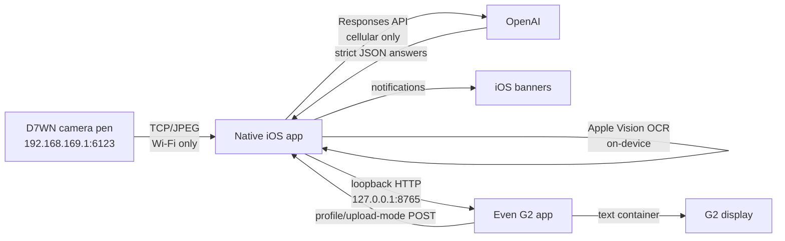

# Pen Camera for iPhone + Even G2

Pen Camera is a private, two-part system for reading questions from a D7WN Wi-Fi camera pen and displaying answers on Even Realities G2 glasses.

- The native iPhone app owns the camera connection, JPEG stream, black-screen batch trigger, Apple Vision OCR, OpenAI request, notifications, and a phone-local HTTP relay.
- The Even G2 app owns the glasses UI, answer scrolling, OCR preview, course/upload-mode selection, and temple controls.
- The two processes do **not** share memory. They communicate through `http://127.0.0.1:8765` on the iPhone.

This README is the primary technical handoff for future developers and coding agents. The phase documents under [`docs/`](docs/) preserve experiment history; when they disagree with the current code, this README and the code are authoritative.

## Current release

| Component | Version | Source of truth |
| --- | ---: | --- |
| Native iOS app | `0.25.0` build `29` | [`project.yml`](project.yml) |
| Even G2 app | `0.8.0` | [`EvenG2/app.json`](EvenG2/app.json), [`EvenG2/package.json`](EvenG2/package.json) |
| iOS deployment target | iOS `26.0` | [`project.yml`](project.yml) |
| Swift | `6.0` | [`project.yml`](project.yml) |
| Default OpenAI model | `gpt-6.1-sol` | [`App/ExamAnalysis.swift`](App/ExamAnalysis.swift) |
| Even Hub SDK | `0.0.16` | [`EvenG2/package.json`](EvenG2/package.json) |

The project has been physically tested primarily with an iPhone 16 Pro on iOS 26.6.1, a D7WN camera pen, and Even G2 glasses.

## Architecture



The split routing is a core requirement:

- Camera traffic must use Wi-Fi because the pen is an access point with no internet route.
- OpenAI traffic must use cellular while the phone remains joined to the camera AP.
- The G2 app uses loopback and never needs an external network path to read native-app state.

Do not replace the cellular-bound OpenAI transport with an ordinary `URLSession`: an earlier physical test showed that iOS can choose the camera Wi-Fi route and make the cloud request fail.

## Hardware baseline

| Item | Verified value |
| --- | --- |
| Camera AP SSID | `Nax_5cf097da7367` |
| Camera endpoint | `192.168.169.1:6123` |
| Camera MAC | `5c:f0:97:da:73:67` |
| Camera firmware | `202607151817` |
| Camera transport | Wi-Fi/TCP, not Bluetooth |
| G2 relay | `127.0.0.1:8765` |

The camera battery percentage is optional. It is shown only if the device-info JSON exposes a recognized battery field containing a value from 0 through 100. There is no separately verified D7WN battery command.

## End-to-end operating flow

1. Join the D7WN AP in iOS Settings and leave cellular data enabled.
2. Open the native **Pen Camera** app.
3. Save an OpenAI API key in the app settings. It is stored in Keychain.
4. Tap **Start Live** and wait for the camera state to become `Live`.
5. Open the private **Pen Camera** app from the Even G2 menu.
6. Tap **Start G2 Analysis** on the phone. This starts the loopback relay, notification permission flow, black-screen monitor, and best-effort continued-processing request.
7. Point the pen at non-black question content. The native app saves distinct frames and performs Apple Vision OCR.
8. Cover the camera. Two consecutive black confirmations end the batch and start one OpenAI request.
9. G2 temporarily shows the black/upload status, then shows quick answers followed by complete questions and answers.
10. After five seconds, the native upload status resets and G2 returns to the answer document.

The native app must remain alive. iOS may grant a `BGContinuedProcessingTask`, but background execution is best effort and iOS may end it. The system is most reliable with the native app in the foreground.

## Capture and black-screen state machine

The continuous flow is implemented in [`App/ExamAnalysisController.swift`](App/ExamAnalysisController.swift).

| State | Behavior |
| --- | --- |
| `stopped` | No continuous sampling or relay-driven batch processing. |
| `startingGlassesRelay` | Binds the loopback listener and requests notification permission. |
| `waitingForImage` | Checks for a fresh frame every 3 seconds. Black frames do not create a batch. |
| `recording` | Samples approximately every 1 second, saves distinct non-black JPEGs, and OCRs every saved JPEG. |
| `uploading` | Stops adding to the active batch and sends exactly one request. |
| `failed` | Continuous processing stopped with an error. |

Important details:

- A frame must be newer than 5 seconds and have a new camera frame number.
- Identical consecutive JPEG byte sequences are deduplicated.
- The black detector downsamples to 32×32 RGB. A frame is black when at least 1004 of 1024 pixels have brightness below 40 and average brightness is below 28.
- Two consecutive black samples are required to finish a non-empty batch.
- A batch is limited to 120 saved images or 50 MiB before Base64 expansion.
- Batch JPEGs live under the app temporary directory and are removed after upload.
- `CameraBatchCapture.recover()` can enumerate leftover batches, but automatic recovery/upload is not currently wired into app startup.
- The selected profile and upload mode are read when upload begins. Changing either setting during capture can affect the current batch.

## Apple Vision OCR

[`App/AppleVisionOCR.swift`](App/AppleVisionOCR.swift) runs locally on the iPhone:

- `VNRecognizeTextRequest`
- `.accurate` recognition level
- English only: `en-US`
- automatic language detection disabled
- language correction enabled
- one OCR operation for every distinct JPEG saved by the one-second sampler
- no OCR for black frames

Each OCR block contains text, confidence, and normalized top-left `x`, `y`, `width`, and `height`. Vision's bottom-left coordinates are converted before storage.

The G2 OCR preview uses an approximate 44-column × 7-row character grid. In **both** upload modes, G2 displays the newest OCR result at most once every two seconds. This display throttle does not remove frames: the native batch still contains each one-second OCR result.

## Upload modes

The mode is selected from the G2 contextual menu and persisted by the native app in `UserDefaults`.

### Images

- The API receives the exact saved JPEGs as `input_image` data URLs.
- Image detail is `high`.
- Apple Vision still runs once per saved JPEG, but OCR is used only for the G2 preview.
- The OCR text is not substituted for the images.

### Apple Vision

- The API receives one `input_text` item containing chronological OCR frames.
- Each block includes normalized position and confidence.
- No JPEG, Base64 image, image URL, or `input_image` item is included.
- Frames with no recognized text remain identifiable, but the request is rejected locally if the whole batch contains no recognized blocks.

Tests in [`Tests/ExamAnalysisTests.swift`](Tests/ExamAnalysisTests.swift) verify that the Apple Vision request is chronological and contains no image input.

## OpenAI request and answer contract

[`App/ExamAnalysis.swift`](App/ExamAnalysis.swift) calls `POST https://api.openai.com/v1/responses` with:

- default model `gpt-6.1-sol`
- reasoning effort `medium`
- `store: false`
- strict JSON Schema output
- a 90-second request timeout
- a custom cellular-only Network.framework TLS/HTTP/1.1 client
- an 8 MiB maximum response size

Each returned question has:

| Field | Meaning |
| --- | --- |
| `question_number` | Printed number, or `x` if unreadable. |
| `opening` | Complete reconstructed question, including readable conditions and choices. |
| `question_type` | `single_choice`, `multiple_choice`, or `other`. |
| `correct_answer` | Used for non-choice answers. |
| `selected_options` | Exact printed identifiers for choice questions. |
| `choice_previews` | Selected option text used to make compact display answers. |
| `certainty` | `certain` or `uncertain`. |

The parser validates the schema again after the API response, rejects inconsistent choice data, and deduplicates questions by question number plus normalized question text.

## Prompt profiles

Profiles live in [`App/AnalysisProfile.swift`](App/AnalysisProfile.swift). The raw values are part of the G2/native relay contract; do not rename them without updating both platforms and migration behavior.

| Raw value | Display name | Scope |
| --- | --- | --- |
| `general` | General | General worksheet and exam questions. |
| `cs0447` | CS 0447 | Computer organization and 32-bit MIPS-oriented questions. |
| `introPsychology` | Intro to Psychology | Introductory psychology concepts and research methods. |
| `introMarketing` | Intro to Marketing | Marketing research, products/services, life cycle, branding, and pricing. |

All profiles share rules for multi-frame reconstruction, uncertainty, option identifiers, question completeness, and ignoring student markings. Course-specific instructions are appended to those shared rules.

## Network implementation

### Camera side

[`App/PenCameraStream.swift`](App/PenCameraStream.swift) uses an `NWConnection` whose required interface type is `.wifi`.

Handshake sequence:

1. TCP connect to `192.168.169.1:6123`.
2. Nax command `115` (`liveMotion`).
3. JSON code `501` (connect).
4. AP JSON code `502`, inner code `4` (base information).
5. AP JSON code `502`, inner code `3` (open video).
6. Command `100` heartbeats every 5 seconds.
7. Parse 20-byte little-endian packet headers and assemble command `1` payloads into JPEGs.

The stream reconnects with exponential delays of 1, 2, 4, then at most 8 seconds. TCP connect timeout is 8 seconds; each handshake step has a 10-second timeout.

### Cloud side

[`App/CellularHTTPSClient.swift`](App/CellularHTTPSClient.swift) uses TLS plus TCP with `.cellular` as the required interface. It verifies the actual current path before sending and has no Wi-Fi fallback. It contains a small HTTP/1.1 response parser supporting content length, chunked bodies, connection-close completion, size limits, and explicit malformed-response errors.

When upload fails, the native app prints a structured `[PenCamera][Upload Failed]` block containing profile, upload mode, model, image bytes, OCR frame/block counts, route, Swift error type, localized description, and `NSError` metadata. It intentionally does not print the API key or Authorization header.

## Loopback relay contract

[`App/GlassesRelayServer.swift`](App/GlassesRelayServer.swift) binds only to `127.0.0.1:8765`. It is not a LAN server.

### Endpoints

| Method | Path | Purpose |
| --- | --- | --- |
| `GET` | `/api/questions?after=<sequence>` | Camera status, analysis status, current settings, newest OCR preview, and questions newer than the requested sequence. |
| `POST` | `/api/settings/profile?value=<rawValue>` | Change the native prompt profile. |
| `POST` | `/api/settings/upload-mode?value=images` | Upload saved JPEGs. |
| `POST` | `/api/settings/upload-mode?value=apple_vision` | Upload OCR text only. |
| `OPTIONS` | any supported route | CORS preflight. |

The snapshot envelope contains:

- a relay `session_id`
- `latest_sequence`
- camera connection state and optional battery
- `is_black`, `upload_state`, and `image_count`
- raw and display names for profile/upload mode
- the latest OCR frame
- newly published questions

The relay retains the most recent 100 questions. G2 also retains at most 100 and persists its session ID, sequence, questions, and scroll position in WebView `localStorage`.

## Even G2 app

The companion lives under [`EvenG2/`](EvenG2/). It is a Vite/TypeScript Even Hub app with one 576×288 text container.

Key behaviors in [`EvenG2/src/main.ts`](EvenG2/src/main.ts):

- polls the relay every 750 ms
- throttles visible OCR content to one update per two seconds
- uses `@evenrealities/pretext` to measure and split text into screen-sized viewports
- presents viewports as one continuous document rather than numbered question pages
- shows quick answers for the whole batch first, then complete questions and detailed answers
- hides the profile/mode/version header on answer viewports to maximize answer space
- retains the header on idle, OCR preview, upload status, and picker views
- gives active capture/upload status priority over previously stored answers

### G2 controls

| Gesture/menu action | Current behavior |
| --- | --- |
| Swipe up/down | Move one viewport or one picker option. |
| Single click on main view | Move down approximately one screen. |
| Left click, then left long press within 2.5 seconds | Clear locally displayed answers. |
| Right double click | Exit picker or request app exit. |
| Context menu: Select Model | Open profile picker. |
| Context menu: Select Upload Mode | Open `Images`/`Apple Vision` picker. |
| Context menu: up/down | Scroll answer view. |
| Context menu: clear | Clear only G2-local displayed answers. |
| Context menu: refresh | Poll relay immediately. |

The contextual menu itself is opened by the Even OS gesture, not by custom TypeScript code.

## Native iOS UI and storage

The main SwiftUI view is [`App/ContentView.swift`](App/ContentView.swift). It exposes live-stream controls, G2 analysis controls, four batch statuses, route diagnostics, counters, frame saving, and TCP testing.

| Data | Storage |
| --- | --- |
| OpenAI API key | iOS Keychain, `WhenUnlockedThisDeviceOnly`, service `com.hongrui.pencamera.openai`. |
| Profile/upload mode | `UserDefaults`. |
| Current model | Initialized to the compiled default; no user-facing model editor currently. |
| Manual saved frame | App Documents folder, visible through Files because file sharing is enabled. |
| Active batch JPEGs | Temporary `PenCameraBatches/<UUID>/` directory. |
| G2 answers/position | G2 WebView `localStorage`. |

The original iOS notification behavior must remain: after every successful batch, each question schedules a banner/list/sound notification. Foreground presentation is enabled through `UNUserNotificationCenterDelegate`.

## Source map

| Path | Responsibility |
| --- | --- |
| `App/PenCameraStream.swift` | D7WN connection, handshake, stream state, reconnect, JPEG publication, optional battery. |
| `App/NaxProtocol.swift` | Nax packet encoding/decoding and request construction. |
| `App/JPEGFrameAssembler.swift` | Reconstruct complete JPEGs across arbitrary TCP packet boundaries. |
| `App/CameraBatchCapture.swift` | Black detection, temporary batch files, deduplication, limits, OCR-frame association. |
| `App/AppleVisionOCR.swift` | Accurate English OCR and normalized geometry. |
| `App/ExamAnalysisController.swift` | One-shot and continuous analysis orchestration/state machine. |
| `App/ExamAnalysis.swift` | Responses API requests, strict schema, response validation/deduplication. |
| `App/AnalysisProfile.swift` | Shared and course-specific prompts. |
| `App/CellularHTTPSClient.swift` | Cellular-only TLS/HTTP client and parser. |
| `App/GlassesRelayServer.swift` | Loopback HTTP relay and setting updates from G2. |
| `App/QuestionNotificationService.swift` | Per-question iOS notifications. |
| `App/BackgroundCaptureCoordinator.swift` | Best-effort iOS continued-processing task. |
| `App/ContentView.swift` | Main phone UI. |
| `EvenG2/src/main.ts` | G2 state, polling, rendering, menu, gestures, picker, OCR layout. |
| `EvenG2/src/paginate.ts` | Firmware-aware text measurement and viewport splitting. |
| `Tests/` | Protocol, JPEG, black-frame, API, parser, and relay tests. |
| `.github/workflows/build-unsigned-ipa.yml` | CI test, G2 package, unsigned arm64 IPA build, artifact upload. |

## Build and test

### Even G2 on Windows or macOS

Node.js 24 is used by CI.

```powershell
cd EvenG2
npm ci
npm run build
npm run pack
```

Outputs:

- `EvenG2/dist/`
- `EvenG2/Pen-Camera-G2.ehpk`

For development and simulation:

```powershell
npm run dev
npm run simulate
```

The simulator is useful for layout and browser events, but it does not prove physical temple-event ordering or iPhone loopback behavior.

### iOS on macOS

```sh
brew install xcodegen
xcodegen generate
xcodebuild \
  -project PenCamera.xcodeproj \
  -scheme PenCamera \
  -configuration Debug \
  -destination 'platform=iOS Simulator,name=iPhone 16 Pro' \
  CODE_SIGNING_ALLOWED=NO \
  test
```

Unsigned device build:

```sh
xcodebuild \
  -project PenCamera.xcodeproj \
  -scheme PenCamera \
  -configuration Release \
  -sdk iphoneos \
  -destination 'generic/platform=iOS' \
  -derivedDataPath build/DerivedData \
  CODE_SIGNING_ALLOWED=NO \
  CODE_SIGNING_REQUIRED=NO \
  CODE_SIGN_IDENTITY='' \
  build

./scripts/package-unsigned-ipa.sh \
  build/DerivedData/Build/Products/Release-iphoneos/PenCamera.app \
  build/package
```

### GitHub Actions

Every push to `main` runs [`Build unsigned IPA`](.github/workflows/build-unsigned-ipa.yml):

1. `npm ci` and `npm run pack` for G2.
2. Generate the Xcode project with XcodeGen.
3. Run all iOS unit tests on a simulator.
4. Build an unsigned arm64 iPhoneOS Release app.
5. Package `PenCamera-unsigned.ipa` and copy `Pen-Camera-G2.ehpk`.
6. Upload a 30-day GitHub Actions artifact named `PenCamera-unsigned-<commit>`.

An unsigned IPA cannot be installed directly. Sign it for the target phone with Sideloadly or another appropriate signing method. Free Personal Team provisioning normally expires after seven days.

## Release checklist

1. Keep the iOS marketing/build versions synchronized in `project.yml`.
2. Keep the G2 version synchronized in `EvenG2/app.json`, `EvenG2/package.json`, `EvenG2/package-lock.json`, and `APP_VERSION` in `EvenG2/src/main.ts`.
3. Run `npm ci`, `npm run build`, and `npm run pack` in `EvenG2/`.
4. Run `git diff --check` and confirm the worktree contains only intended changes.
5. Commit and push to `main`.
6. Wait for the complete GitHub Actions job, including simulator tests and arm64 packaging.
7. Download both artifacts and keep versioned filenames for local delivery.
8. Physically verify the camera route, cellular cloud route, G2 relay, both upload modes, temple gestures, answer order, and notification banners.

Generated `.xcodeproj`, `build/`, `DerivedData/`, `EvenG2/dist/`, `EvenG2/node_modules/`, and `.ehpk` files are intentionally ignored and should not be committed.

## Tests and verification status

Automated coverage includes:

- Nax request bytes and fragmented packet parsing
- JPEG SOI/EOI assembly and frame limits
- black-frame thresholds
- image and OCR OpenAI request construction
- strict response parsing and rejection cases
- question deduplication
- relay snapshots, settings, camera state, OCR preview, and batch grouping
- G2 TypeScript compilation and packaging
- unsigned arm64 iPhoneOS build

Physically verified:

- D7WN AP TCP access from iPhone
- complete native handshake and live JPEG display
- saving a current frame
- simultaneous camera Wi-Fi plus cellular-bound OpenAI access
- Sideloadly installation of the unsigned-then-resigned IPA

Accuracy across all exam layouts and the exact behavior of every firmware/event-version combination remain physical-test concerns.

## Known issues and limitations

1. **G2 picker confirmation is not yet robust.** `eventTypeOf()` currently treats a present event with no explicit `eventType` as `CLICK_EVENT`. The picker has no entry cooldown, no save-in-flight lock, and no on-glasses POST failure message. A residual event after opening the menu can potentially confirm immediately, rapid clicks can create duplicate requests, and a failed POST can leave the picker open with an unhandled promise. The intended fix is to ignore missing event types, add a short picker-entry cooldown, serialize saves, and show failure state before returning to `main`.
2. Apple Vision is deliberately English-only. Mixed-language questions need an explicit product decision before changing recognition languages.
3. G2 OCR placement is approximate text-grid placement, not pixel-accurate image reproduction.
4. The G2 app cannot replace the native camera/network process. Even Hub runs a WebView app and the native iOS app is still required for D7WN TCP, Vision OCR, Keychain, cellular-bound TLS, and notifications.
5. Background capture is not guaranteed. iOS can deny or expire the continued-processing task.
6. The custom cloud HTTP parser has previously surfaced failures such as missing HTTP headers. Detailed upload logs are the first diagnostic source.
7. Batch limits are measured before JSON/Base64 overhead, so Images requests are larger on the wire than the saved JPEG byte count.
8. The relay is intentionally loopback-only and unauthenticated. Do not change it to a LAN listener without adding authentication and reevaluating data exposure.

## Invariants for future agents

Unless the user explicitly changes the product requirements, preserve these behaviors:

- Camera TCP is Wi-Fi-only; OpenAI is cellular-only; no automatic Wi-Fi cloud fallback.
- Images mode analyzes the saved original JPEGs.
- Apple Vision mode sends OCR text only and sends no image data.
- Both modes OCR every distinct one-second saved frame.
- Both modes throttle only the visible G2 OCR preview to two seconds.
- Two black confirmations finish and upload a batch.
- Answers appear as a batch-wide quick overview followed by complete questions and detailed answers.
- Answers scroll as one long document; they are not one-question-per-page navigation.
- Answer viewports do not reserve space for the profile/mode/version header.
- Status views continue to expose black state, upload start, upload finish, and image count.
- The left click-then-long-press clear gesture and the right-side contextual menu remain available.
- iOS notification pop-ups remain enabled after successful analysis.
- Never commit or log API keys, Apple credentials, signing material, or provisioning profiles.
- Preserve unrelated user changes in a dirty worktree.

## Historical documents

- [`docs/PHASE0.md`](docs/PHASE0.md): Windows → GitHub Actions → unsigned IPA → Sideloadly path.
- [`docs/PHASE1.md`](docs/PHASE1.md): AP-mode TCP experiment.
- [`docs/PHASE2-3.md`](docs/PHASE2-3.md): native Nax/JPEG stream implementation.
- [`docs/PHASE4.md`](docs/PHASE4.md): cellular-bound OpenAI experiment and one-shot analysis.
- [`docs/PHASE5.md`](docs/PHASE5.md): Even G2 relay and display evolution.

Status vocabulary used in those documents:

- **VERIFIED**: observed on hardware or completed successfully by CI.
- **LIKELY**: supported by code/documentation but not yet physically tested.
- **UNKNOWN**: requires a targeted experiment.
